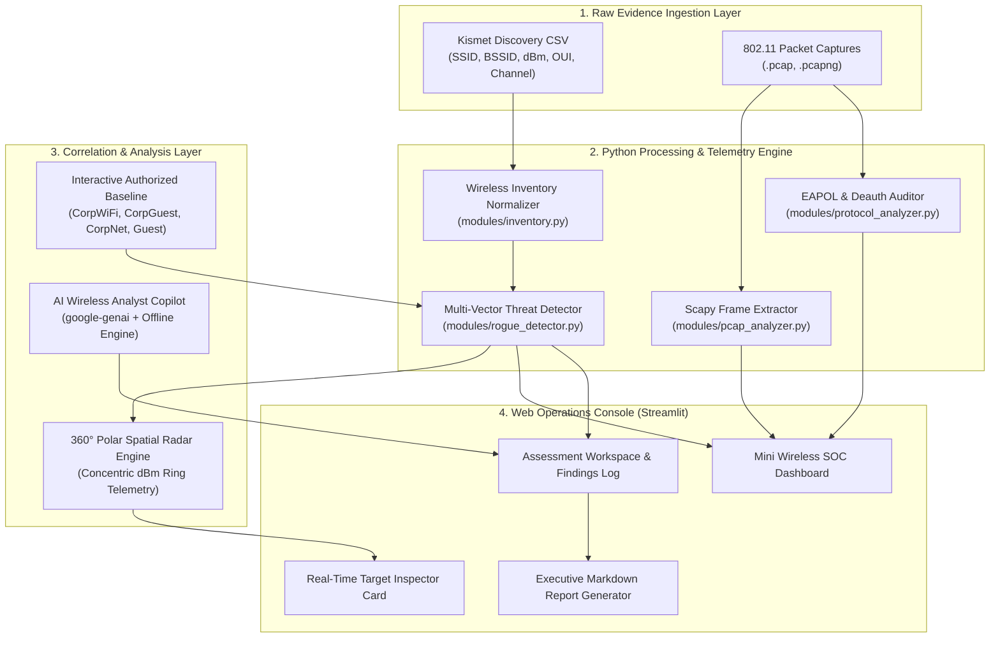

# 🛡️ Project AirGuard: AI-Assisted Wireless Security Platform

> **NWIT 275 — Wireless Security & Ethical Penetration Testing**  
> *A portfolio-ready wireless security assessment platform integrating packet analysis, spatial RF telemetry, AI copilot reasoning, and verified remediation reporting.*

---

## 📋 Executive Overview & Mission
Modern wireless environments face complex, evasive threats ranging from Evil Twin AP clones and homoglyph typo-squatting to Karma beacon floods and high-rate deauthentication DoS attacks. Traditional command-line tools isolate capture data into static logs that require manual, error-prone correlation.

**Project AirGuard** unifies 802.11 passive discovery, packet capture inspection, and AI copilot reasoning into a centralized, operations-grade platform. Built under the **Evidence-First Rule**, every automated detection and AI conclusion links directly to verified raw evidence (packet timestamps, BSSIDs, and Wireshark display filters).

---

## 🏛️ System Architecture



---

## 🚀 Core Platform Modules

| Module | Purpose & Technical Implementation | NWIT 275 Roadmap Phase |
|---|---|---|
| **📡 Dashboard** | **Mini Wireless SOC**: Real-time hero metrics, 360° Polar Spatial Radar, carrier spectrum utilization (2.4 GHz vs 5 GHz loads), correlated threat matrix, and live packet stream. | *Week 1-2 & Section 12* |
| **📋 Wireless Inventory** | Normalized 802.11 emitter database with dynamic multi-filtering by security type (WPA3, WPA2, Open, WEP) and risk tier (Critical, High, Medium, Low). | *Weeks 3-4* |
| **🔍 PCAP Analyzer** | Frame extraction engine parsing Beacons, Probes, Authentication, Deauth, and EAPOL handshakes with verified Wireshark display filter references. | *Weeks 5-6* |
| **🤖 AI Copilot Analyst** | Context-aware security analyst with built-in Hallucination & Verification Challenge logs to train analysts on distinguishing AI claims from packet facts. | *Weeks 7-8* |
| **⚡ Protocol Analysis** | Deep-packet inspection of WPA/WPA2 4-way key exchanges (EAPOL Message 1-4) and statistical deauthentication burst attack monitoring (0x0c/0x0a). | *Weeks 9-11* |
| **🎯 Rogue AP & Evil Twin** | 360° Polar Spatial Radar with clickable Target Inspector Card, custom authorized baseline editor, and multi-vector threat detection. | *Week 10* |
| **🛡️ Assessment Workspace** | Rules of Engagement manager, authorized scope definitions, and interactive Findings & Remediation Tracker (`FIND-xx`). | *Weeks 12-13* |
| **📄 Executive Reports** | Automated Markdown report generator combining scope, findings, packet evidence, and the Week 15 Platform Hardening Checklist. | *Weeks 14-15* |

---

## 🎯 Threat Detection Capabilities

Project AirGuard's threat correlation engine (`modules/rogue_detector.py`) automatically evaluates observed RF environments against authorized corporate baselines to pinpoint 5 distinct wireless threat classes:

1. **Exact Evil Twin Access Points**: Cloned authorized SSIDs broadcasting with encryption downgrades (e.g. WPA2 to Open) or non-matching vendor OUIs.
2. **Homoglyph & Typo-Squatting Clones**: Sophisticated attacker traps mimicking legitimate SSIDs using visually identical lookalikes (e.g., `C0rpWiFi` using zero, `CorpWiFl` using lowercase L, or trailing hidden whitespace).
3. **Multi-SSID Karma / Beacon Floods**: Rogue hardware (such as Hak5 WiFi Pineapples) broadcasting multiple disparate SSIDs from a single physical radio BSSID.
4. **Auditing Hardware Signatures**: Active emitter detection matching known pentest devices (`Pineapple5_A1B2`, Alfa Network `00:C0:CA` OUIs).
5. **Insecure Legacy Protocols**: Identification of deprecated 802.11 WEP networks vulnerable to statistical IV replay key recovery.

---

## ⚙️ Installation & Quickstart

### Prerequisites
- Python 3.10 to 3.14
- Operating System: Windows, macOS, or Linux

### 1. Clone the Repository
```bash
git clone https://github.com/your-username/PROJECT_AIRGUARD.git
cd PROJECT_AIRGUARD
```

### 2. Install Dependencies
```bash
pip install -r requirements.txt
```

### 3. Launch the Platform
```bash
streamlit run app.py
```
Open **`http://localhost:8501`** in your browser.

---

## 🧪 Testing with Included Lab Evidence

The repository includes pre-packaged lab datasets in the `data/` directory for immediate evaluation:
- **`data/sample_kismet.csv`**: Baseline 5-AP lab discovery capture.
- **`data/kismet_lab_capture_34aps.csv`**: Comprehensive 34-emitter enterprise dataset containing Evil Twins, Hak5 Pineapple signatures, WEP networks, and homoglyph clones.

---

## ⚖️ Safety, Ethics & Rules of Engagement
- **Educational / Lab Boundary**: Project AirGuard is strictly designed for authorized educational laboratory environments, pre-captured packet files, and approved client penetration testing scopes.
- **No Active Denial of Service**: The platform operates in passive ingestion and analysis mode; it does not transmit unapproved deauthentication or jamming frames into production airspace.
- **Evidence-First Rule**: AI reasoning serves solely as an analytical assistant. All findings must be corroborated against raw packet timestamps and Wireshark display filters before submission.
